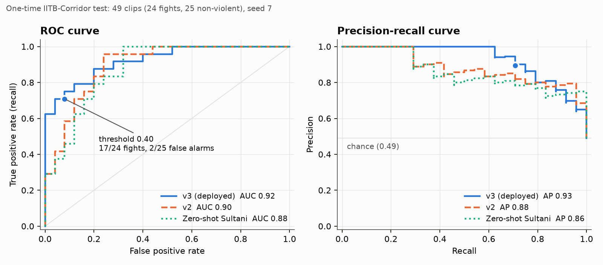

# Model performance summary (Indian pilot, v3 demo model)

This page summarises how the model in the demo performs. Every number comes from a saved results
file in `runs/indian_pilot/`; nothing here was re-run or re-tuned for this page.

**The model:** a binary violence head (`v3_all_s7`) on frozen C3D FC6 features. It was trained
on Indian clips, DCSASS, UBI-Fights and XD-Violence. Alert threshold: **0.40**, chosen on
validation data only (best F1 with recall ≥ 0.8).
Spec: [`runs/indian_pilot/demo/indian_pilot_spec_v3.json`](../../runs/indian_pilot/demo/indian_pilot_spec_v3.json).

## Headline: the held-out test set

The test set is **49 two-second clips from IITB-Corridor**, a campus CCTV dataset from India.
24 clips show fighting and 25 do not. No IITB footage was used for training or tuning. The
test was scored **once**, under a protocol committed beforehand
([`V3_PROTOCOL.md`](../../runs/indian_pilot/V3_PROTOCOL.md)), and the evaluation script
refuses to run a second time.

### At the alert threshold (0.40)

| Metric | Value | Meaning |
|---|---:|---|
| **Accuracy** | **81.6%** (40/49) | clips classified correctly |
| **Recall / sensitivity** | **70.8%** (17/24) | fights the model caught |
| **Specificity** | **92.0%** (23/25) | non-violent clips correctly left alone |
| **Precision** | **89.5%** (17/19) | alerts that were real fights |
| False-positive rate | 8.0% (2/25) | non-violent clips that raised an alert |
| **F1 score** | **0.79** | balance of precision and recall |
| Balanced accuracy | 81.4% | mean of sensitivity and specificity |
| Negative predictive value | 76.7% (23/30) | "no alert" clips that really were non-violent |

**Confusion matrix**

| | Predicted non-violent | Predicted violent |
|---|---:|---:|
| **Actually non-violent (25)** | 23 (true negatives) | 2 (false alarms) |
| **Actually violent (24)** | 7 (missed fights) | 17 (caught fights) |

### Ranking quality (no threshold needed)

| Metric | v3 (deployed) | 95% CI |
|---|---:|---|
| **ROC-AUC** | **0.92** | 0.85 – 0.98 |
| **PR-AUC** (average precision) | **0.93** | 0.84 – 0.98 |
| Within-video ROC-AUC | 0.92 | 0.80 – 1.00 |

The ROC-AUC and PR-AUC above are averages over three training seeds (7, 8, 9); the seeds agree
to within 0.001. CIs are a cluster bootstrap over the 18 test videos (2,000 resamples).
"Within-video" asks whether the model ranks the fight above the calm moments **of the same
video**, so it cannot score well just by recognising a camera.

*The dot marks the 0.40 operating point. Regenerate with
`python scripts/pilot_v3_figures.py --output docs/results/pilot_v3_iitb_curves.png`.*

## Compared with the earlier models on the same 49 clips

| Model | ROC-AUC | PR-AUC | Accuracy at its own threshold | Fights caught | False alarms |
|---|---:|---:|---:|---:|---:|
| **v3 (deployed), 0.40** | **0.92** | **0.93** | **81.6%** | **17/24** | **2/25** |
| v2 (Indian + DCSASS), 0.45 | 0.90 | 0.88 | 51.0% | 0/24 | 0/25 |
| Zero-shot Sultani (UCF-Crime), 0.50 | 0.88 | 0.86 | 51.0% | 0/24 | 0/25 |
| v1 (Indian clips only), 0.40 | 0.73 | 0.75 | 49.0% | 24/24 | 25/25 |

Both v2 and Sultani rank the clips well. Their scores, though, all fall below their thresholds,
so on this camera they never raise an alert. v1 alerts on every clip. v3 is the only model with
a threshold that works on this footage.

## Validation results (used to pick the model and threshold)

2,001 validation clips, seed 7, before the test was touched:

| Validation subset | Clips | PR-AUC | ROC-AUC |
|---|---:|---:|---:|
| All | 2,001 | 0.64 | 0.73 |
| Indian | 79 | 0.93 | 0.99 |
| DCSASS | 862 | 0.57 | 0.63 |
| UBI-Fights | 500 | 0.57 | 0.68 |
| XD-Violence | 560 | 0.79 | 0.86 |

Sanity check: at 0.40, 7.3% of documented Indian non-violent validation clips raise an alert
(the protocol's limit was 10%).

## Limitations

Read these before quoting the numbers.

1. **v3 vs v2 is not a proven improvement.** The pre-registered test asked whether v3 beats v2
   with the 95% CI excluding zero. It did not: PR-AUC +0.06 (CI −0.06 to +0.24), within-video
   ROC-AUC −0.002. The answer is **"not shown"**.
2. **The threshold choice is post hoc.** The protocol said to keep v2 in the demo. The team
   switched to v3 *after* seeing the test, because it catches 17/24 fights where v2 catches
   none ([D30](../../runs/indian_pilot/DECISIONS.md)). Present it that way.
3. **The test is small and narrow.** 49 clips, but all 24 fights come from 8 videos of one
   staged corridor scene. The CIs are wide, and results may not carry over to street,
   market or crowd footage.
4. **The margin is thin.** Median fight score 0.44; highest non-violent score 0.42; threshold
   0.40. Small changes in camera, lighting or clip length can move clips across the line.
5. **Labels are pilot quality.** The Indian training labels are team-annotated and not
   adjudicated.
6. **Not tested on DCSASS.** The v2 DCSASS test sources became v3 training data, so v3 has no
   DCSASS test score.
7. **For human review only.** The score is uncalibrated. It flags clips for a person to look
   at. It never decides anything and says nothing about anyone's identity or intent.

## Source files

| What | File |
|---|---|
| Test results (all models, per-clip scores) | [`runs/indian_pilot/test_results_v3.json`](../../runs/indian_pilot/test_results_v3.json) |
| Validation results | [`runs/indian_pilot/validation_results_v3.json`](../../runs/indian_pilot/validation_results_v3.json) |
| Pre-registered protocol | [`runs/indian_pilot/V3_PROTOCOL.md`](../../runs/indian_pilot/V3_PROTOCOL.md) |
| Decision log (D26–D30 cover v3) | [`runs/indian_pilot/DECISIONS.md`](../../runs/indian_pilot/DECISIONS.md) |
| Earlier pilot report (v1, v2) | [`runs/indian_pilot/REPORT.md`](../../runs/indian_pilot/REPORT.md) |

Accuracy, specificity, balanced accuracy and NPV are computed from the confusion matrix in
`test_results_v3.json`; the other figures are copied from it directly.
